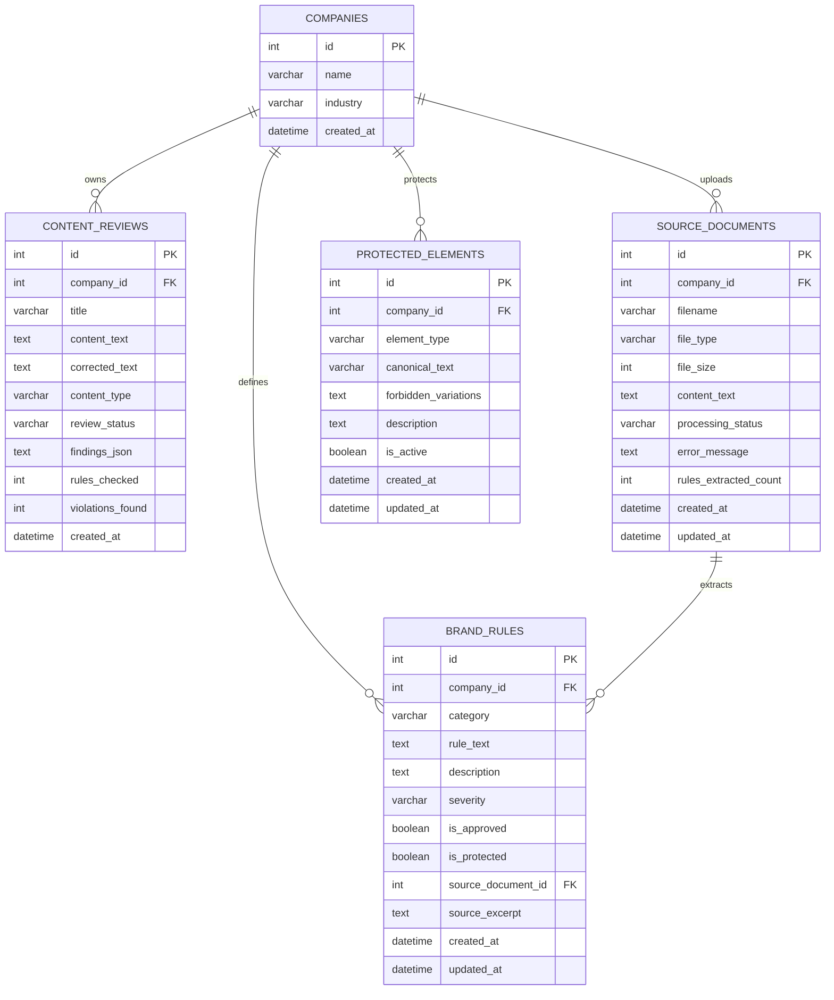

# Database Design — Brandguard AI

## Overview

The database uses **MySQL 8** managed through **SQLAlchemy 2.0** ORM with the **PyMySQL** driver.

All models share a single declarative base defined in `backend/app/db/base.py`.

---

## Entity Relationship Overview



---

## Tables & Schema Specifications

### 1. `companies`
Stores company or organization workspaces.

| Column | Type | Constraints | Description |
|---|---|---|---|
| `id` | INT | Primary Key, Auto-increment | Unique identifier |
| `name` | VARCHAR(200) | NOT NULL | Company name |
| `industry` | VARCHAR(100) | NULL | Industry sector |
| `created_at` | DATETIME | NOT NULL, DEFAULT NOW() | Timestamp of creation |

### 2. `source_documents`
Stores uploaded policy documents (PDF, DOCX, TXT) and parsing status.

| Column | Type | Constraints | Description |
|---|---|---|---|
| `id` | INT | Primary Key, Auto-increment | Unique document ID |
| `company_id` | INT | Foreign Key (`companies.id`), NULL, ON DELETE CASCADE | Scoped company |
| `filename` | VARCHAR(255) | NOT NULL | Cleaned original filename |
| `file_type` | VARCHAR(20) | NOT NULL | `pdf`, `docx`, `txt` |
| `file_size` | INT | NOT NULL, DEFAULT 0 | Size in bytes |
| `content_text` | TEXT | NULL | Extracted text content |
| `processing_status` | VARCHAR(50) | NOT NULL, DEFAULT 'uploaded' | `uploaded`, `completed`, `failed` |
| `error_message` | TEXT | NULL | Parsing error details |
| `rules_extracted_count`| INT | NOT NULL, DEFAULT 0 | Count of candidate rules discovered |
| `created_at` | DATETIME | NOT NULL, DEFAULT NOW() | Upload timestamp |
| `updated_at` | DATETIME | NOT NULL, DEFAULT NOW() | Last update timestamp |

### 3. `brand_rules`
Defines brand governance guidelines.

| Column | Type | Constraints | Description |
|---|---|---|---|
| `id` | INT | Primary Key, Auto-increment | Unique rule ID |
| `company_id` | INT | Foreign Key (`companies.id`), NULL, ON DELETE CASCADE | Scoped company |
| `category` | VARCHAR(50) | NOT NULL | `prohibited_phrase`, `required_phrase`, `required_disclaimer`, `brand_terminology` |
| `rule_text` | TEXT | NOT NULL | Phrase or approved term |
| `description` | TEXT | NULL | Guidance or comma-separated variants |
| `severity` | VARCHAR(20) | NOT NULL, DEFAULT 'warning' | `critical`, `warning`, `info` |
| `is_approved` | BOOLEAN | NOT NULL, DEFAULT FALSE | Authoritative switch (draft vs approved) |
| `is_protected` | BOOLEAN | NOT NULL, DEFAULT FALSE | Prevents accidental modification/deletion |
| `source_document_id` | INT | Foreign Key (`source_documents.id`), NULL, ON DELETE SET NULL | Originating document |
| `source_excerpt` | TEXT | NULL | Excerpt from policy source |
| `created_at` | DATETIME | NOT NULL, DEFAULT NOW() | Creation timestamp |
| `updated_at` | DATETIME | NOT NULL, DEFAULT NOW() | Last update timestamp |

### 4. `content_reviews`
Records evaluated content drafts, audit findings, and accepted revisions.

| Column | Type | Constraints | Description |
|---|---|---|---|
| `id` | INT | Primary Key, Auto-increment | Unique review ID |
| `company_id` | INT | Foreign Key (`companies.id`), NULL, ON DELETE CASCADE | Scoped company |
| `title` | VARCHAR(255) | NULL | Title or reference identifier |
| `content_text` | TEXT | NOT NULL | Original submitted draft |
| `corrected_text` | TEXT | NULL | User-accepted revised copy |
| `content_type` | VARCHAR(50) | NOT NULL, DEFAULT 'general' | Channel (email, social_post, etc.) |
| `review_status` | VARCHAR(20) | NOT NULL, DEFAULT 'no_rules' | `pass`, `fail`, `no_rules` |
| `findings_json` | TEXT | NULL | Serialized JSON array of findings |
| `rules_checked` | INT | NOT NULL, DEFAULT 0 | Count of approved rules evaluated |
| `violations_found`| INT | NOT NULL, DEFAULT 0 | Count of violations detected |
| `created_at` | DATETIME | NOT NULL, DEFAULT NOW() | Submission timestamp |

### 5. `protected_elements`
Catalogs core brand assets and specifications that must never be altered automatically.

| Column | Type | Constraints | Description |
|---|---|---|---|
| `id` | INT | Primary Key, Auto-increment | Unique identifier |
| `company_id` | INT | Foreign Key (`companies.id`), NULL, ON DELETE CASCADE | Scoped company |
| `element_type` | VARCHAR(50) | NOT NULL | `brand_name`, `product_name`, `slogan`, `legal_disclaimer`, `product_spec` |
| `canonical_text` | VARCHAR(255) | NOT NULL | Exact approved wording/spelling |
| `forbidden_variations`| TEXT | NULL | Comma-separated unapproved variants |
| `description` | TEXT | NULL | Contextual notes |
| `is_active` | BOOLEAN | NOT NULL, DEFAULT TRUE | Active flag |
| `created_at` | DATETIME | NOT NULL, DEFAULT NOW() | Creation timestamp |
| `updated_at` | DATETIME | NOT NULL, DEFAULT NOW() | Last update timestamp |

---

## Database Initialization & Seeding

To create tables and seed default starter guidelines:

```powershell
cd backend
python -m app.db.init_db
```
